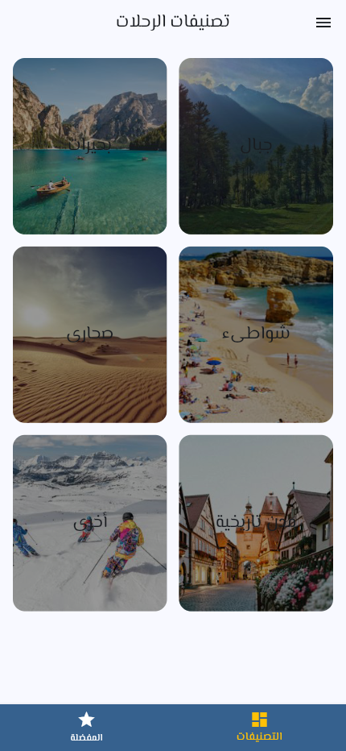
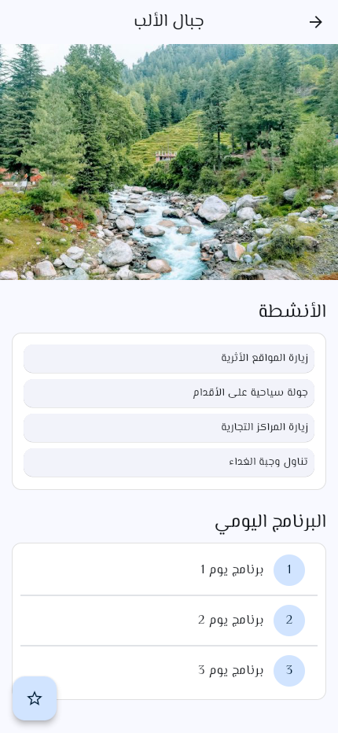

# Travel Explorer

An Arabic Flutter travel-browsing application with destination categories, trip details, favorites, and filters. The repository name is traviling_app; the Dart package is traveling_app.

## Features

- Browse a bundled catalog by destination category.
- Read trip descriptions, activities, and program details.
- Toggle favorite trips and view them in a separate tab.
- Filter the available catalog using summer, winter, and family preferences.

Favorites and filters live in widget state and reset when the app restarts. There is no booking service, payment, authentication, database, or remote travel API. Trip photography uses remote image URLs, so images need network access.

## Screenshots

Real mobile-viewport captures from the local Flutter web build.

| Categories | Category trips | Trip details |
| --- | --- | --- |
|  |  |  |

## Stack and layout

Flutter, Dart, Material 3, Flutter localizations, and the bundled ElMessiri font. The Arabic interface uses RTL navigation. lib/app_data.dart contains the catalog; lib/models, lib/screens, and lib/widgets separate data shapes, pages, and reusable UI. lib/main.dart owns filters and favorites.

## Run

Install Flutter with Dart 3.10.8 or a compatible SDK, then run from this folder:

```sh
flutter pub get
flutter run -d chrome
flutter build web --release --no-web-resources-cdn
```

No credentials are required. Serve build/web with an HTTP server to preview the release output.

## Project status

The web release build passed with Flutter 3.38.9. Categories, a category list, and a trip detail were opened locally. This review did not validate native mobile packages or every filter/favorite combination. Some photo overlays have low text contrast; improving accessibility is a future UI task.
